

  

<h1 align="center">Solevia · 足下</h1>

  <strong>从模糊想法到清晰行动，AI 陪你走出第一步</strong> 
  能聊清需求、规划路线、陪你执行的智能规划助手

  
  
  

  <a href="https://github.com/yqf66/Solevia/releases/latest"><strong>下载 Windows 版</strong></a> ·
  <a href="START_HERE.md">安装指南</a> ·
  <a href="docs/CODEX_CONNECTION.md">连接 Codex</a> ·
  <a href="https://github.com/yqf66/Solevia/issues">交流与反馈</a>

  

---

## 🎉 0.2.0 重大更新：一套工作台，两种 AI 内核

> **突破性改进**：现在可以**接入本机 Codex**，或使用自己的模型 API。  
> 从一句想法，到今天能做的一步——**降低使用门槛，增强规划能力**。

| 更新亮点 | 现在你可以 |
|---------|-----------|
| 🔌 **双内核自由切换** | 本机 Codex 或自配置 API，共用同一份目标、对话和记录 |
| 🎯 **安装时一键接入** | 自动检测本机 Codex，明确询问是否连接（可跳过，稍后配置） |
| 📁 **文件处理回到对话** | 导入文件/文件夹，Codex 确认后生成独立修改版，直接预览下载 |
| 🎨 **重新打磨的界面** | 更清晰的卡片层次、更明亮的配色、更流畅的交互反馈 |
| 💬 **更轻巧的讨论小窗** | 独立字号、紧凑输入栏，长回复可展开阅读，草稿与上下文保留 |
| 🔄 **恢复调整更清楚** | 逐项比较原日期与新日期、每日用时和结束日期变化 |

完整变化见 [0.2.0 更新记录](CHANGELOG.md)。

---

## 💡 为什么选择 Solevia？

### 你是否遇到过这些困扰？

- 💭 **"想学 XX，但不知道从哪开始"** → Solevia 从一句话开始，帮你理清路线
- 📅 **"计划总是赶不上变化"** → 灵活调整，已完成的进度不会白费
- 🎯 **"每天不知道该做什么"** → 打开就看到今天最值得推进的任务
- 🔄 **"坚持一段时间就放弃了"** → 结合你的时间和节奏，持续陪伴

### ✨ Solevia 不是又一个待办清单

<table>
<tr>
<td width="50%"><a href="docs/assets/solevia/overview.webp">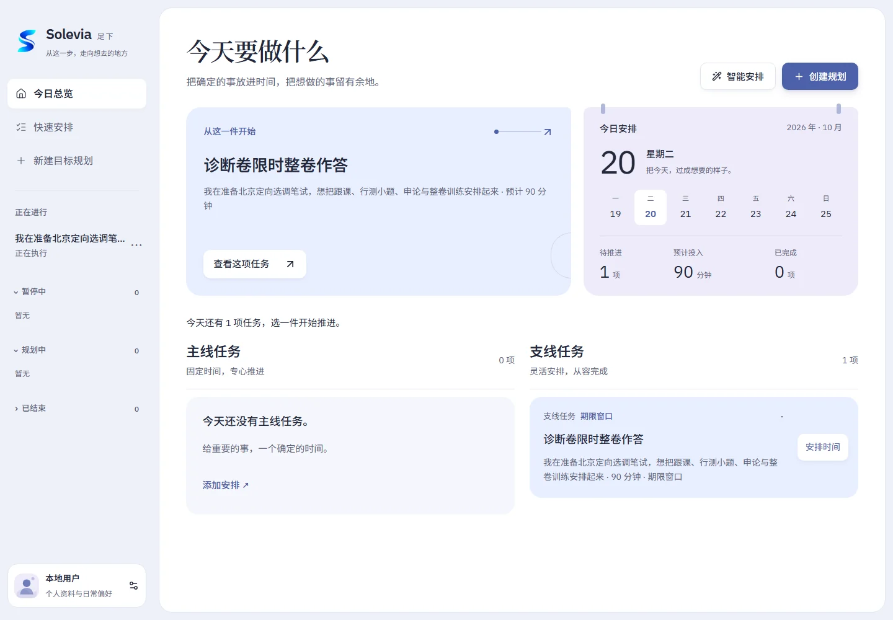</a> <strong>今天，从哪一件开始</strong> · 首页总览</td>
<td width="50%"><a href="docs/assets/solevia/execution-beijing.webp">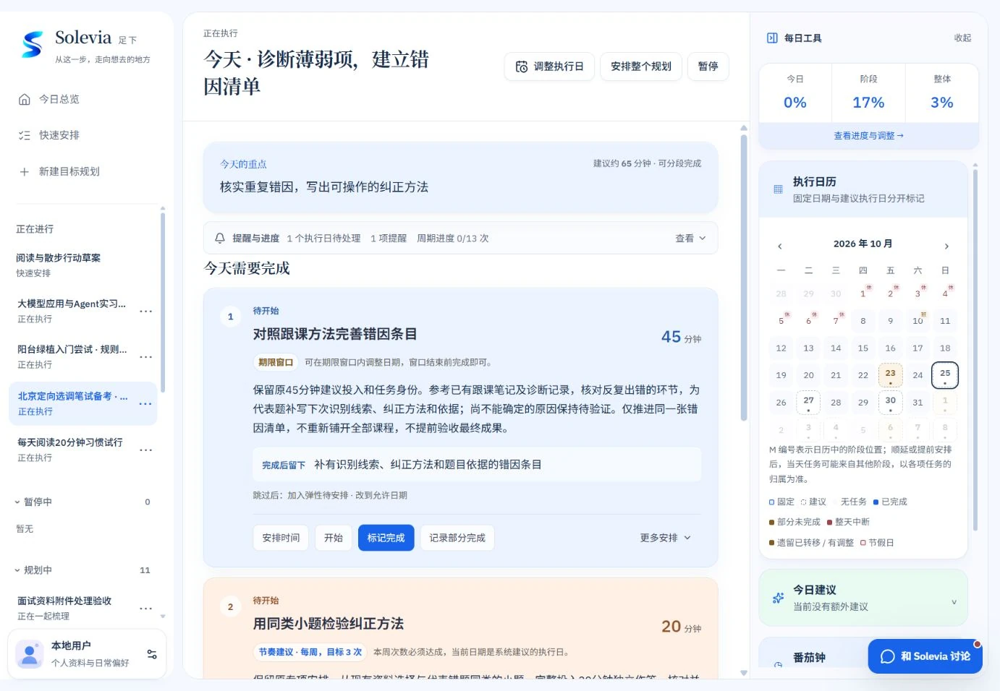</a> <strong>把计划变成行动</strong> · 实际执行页</td>
</tr>
<tr>
<td><a href="docs/assets/solevia/route-detail.webp">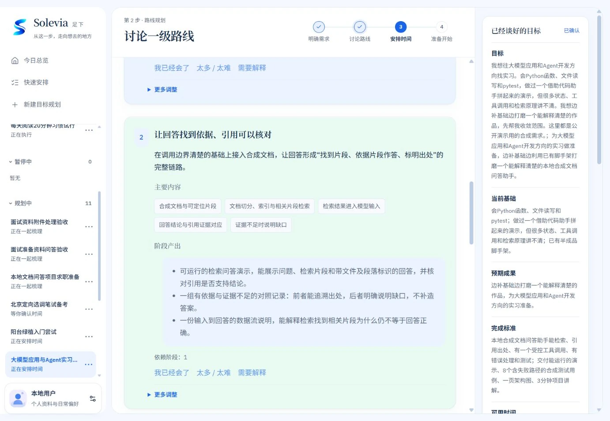</a> <strong>看清每一步的方向</strong> · 阶段路线</td>
<td><a href="docs/assets/solevia/plan.webp">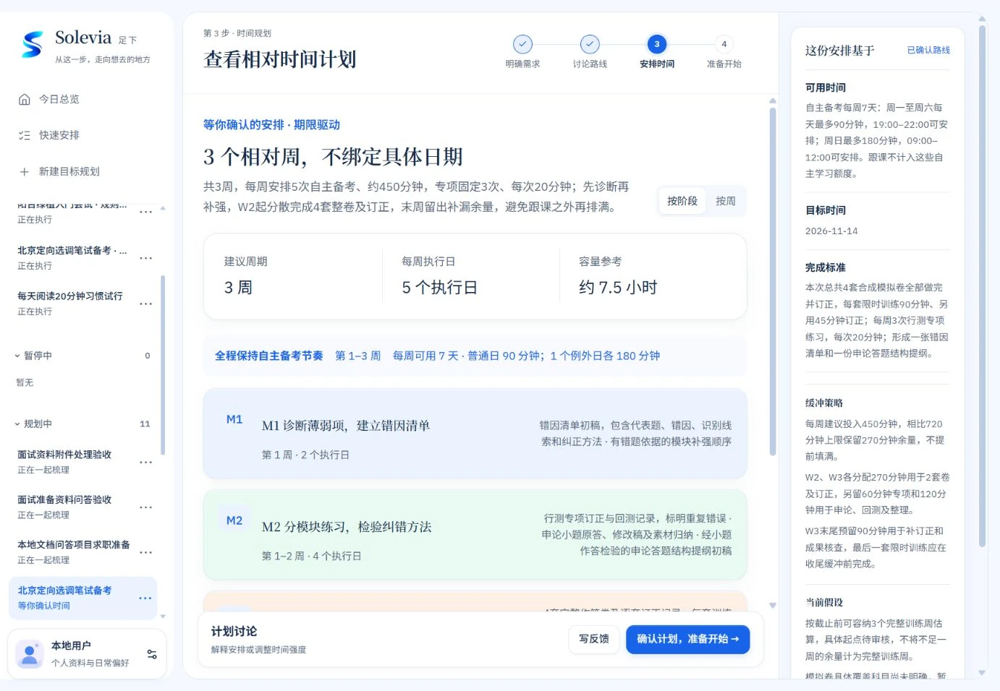</a> <strong>安排适合自己的节奏</strong> · 计划审核</td>
</tr>
<tr>
<td><a href="docs/assets/solevia/discussion.webp">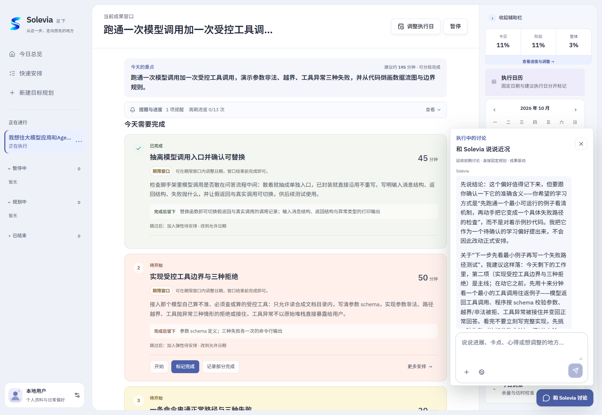</a> <strong>卡住时，接着聊</strong> · 随行讨论</td>
<td><a href="docs/assets/solevia/focus.webp">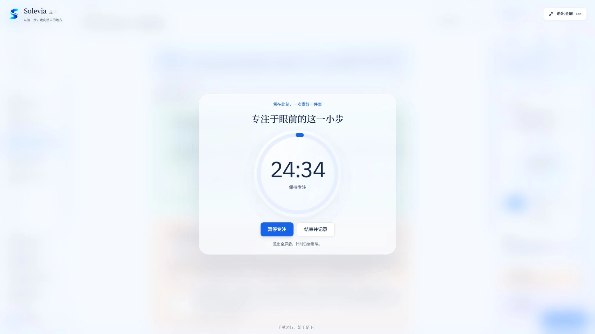</a> <strong>只专注眼前这一件</strong> · 番茄钟</td>
</tr>
<tr>
<td><a href="docs/assets/solevia/files.webp">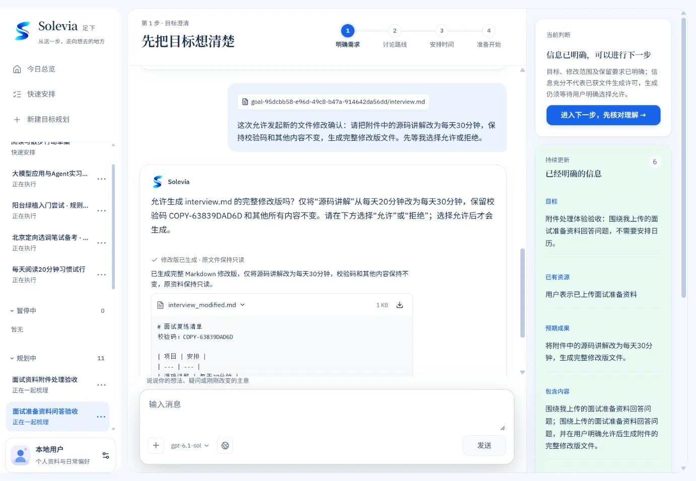</a> <strong>带着资料一起工作</strong> · 文件处理</td>
<td><a href="docs/assets/solevia/installer.webp">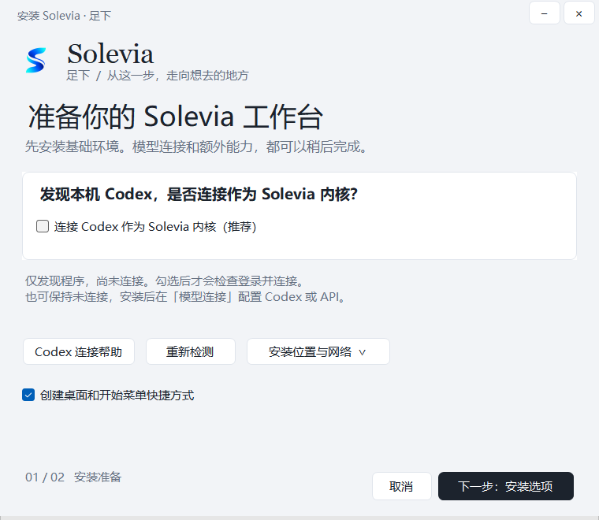</a> <strong>按需连接，轻装出发</strong> · 新版安装向导</td>
</tr>
<tr>
<td><a href="docs/assets/solevia/recovery-summary.webp">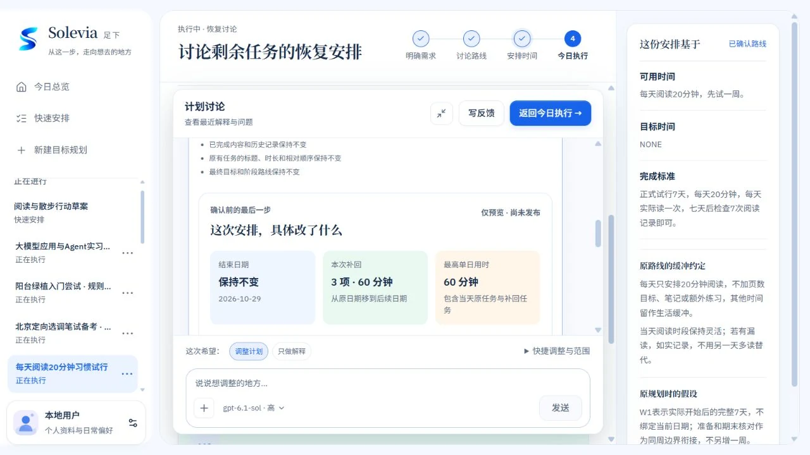</a> <strong>中断之后，接着走</strong> · 恢复调整总览</td>
<td><a href="docs/assets/solevia/recovery-comparison.webp">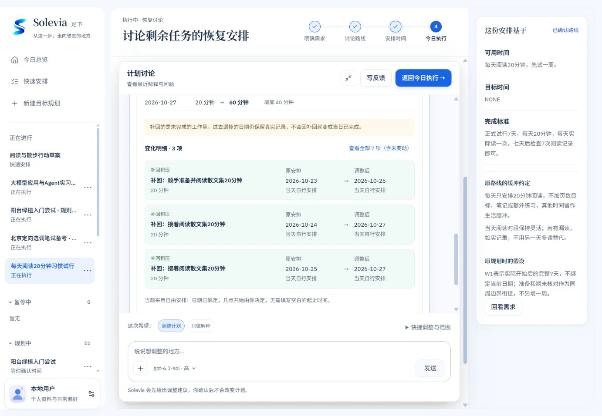</a> <strong>改了什么，一目了然</strong> · 调整前后对照</td>
</tr>
</table>

*点击图片可查看原尺寸。所有配图保留完整工作区，使用合成演示案例。*

---

## 🚀 快速开始（3 步上手）

### 方式一：接入本机 Codex（推荐）

1. **安装 Solevia** 
   下载 [Solevia-Setup-0.2.0-windows-x64.exe](https://github.com/yqf66/Solevia/releases/latest)，安装向导自动检测本机 Codex，询问是否连接

2. **准备 Codex**（已安装并登录可跳过） 
   按 [OpenAI Codex 官方安装指南](https://learn.chatgpt.com/docs/cli)安装，并按[登录说明](https://learn.chatgpt.com/docs/auth)完成登录。回到 Solevia，在「模型连接 → Codex」点击「检测并连接」

3. **开始第一个目标**  
   打开 Solevia，输入你的想法："我想学会做视频剪辑，但完全没基础"

### 方式二：使用自己的 API

1. **安装 Solevia**
2. **配置模型服务**：打开「本地用户 → 模型连接」，选择「自配置 API」，填写 API 地址、Key 和模型名称
3. **开始规划**：输入目标，Solevia 开始工作

> 💡 **两种方式可以自由切换**，共用同一份目标、对话和执行记录。

---

## 🎯 双内核对比：选择适合你的方式

| | Codex 内核 | 自配置 API |
|---|---|---|
| **如何连接** | 安装时检测询问，或稍后主动连接 | 填写接口地址、模型名称与 API Key |
| **模型选择** | 输入栏选择 Codex 支持的模型及思考强度 | 从服务商读取模型目录，或手动输入 |
| **联网检索** | 使用 Codex 原生搜索，无需额外配置 | 可选安装 Solevia 联网与文档组件 |
| **文件处理** | ✅ 生成独立修改版，原件只读 | 阅读资料、查看已有产物 |
| **本地依赖** | 基础对话无需 BGE/E5 模型 | 按需安装联网、文档、OCR、语义查找 |
| **适合场景** | 想要开箱即用，已有 Codex 环境 | 已有其他服务商 API，或需要完全自主配置 |

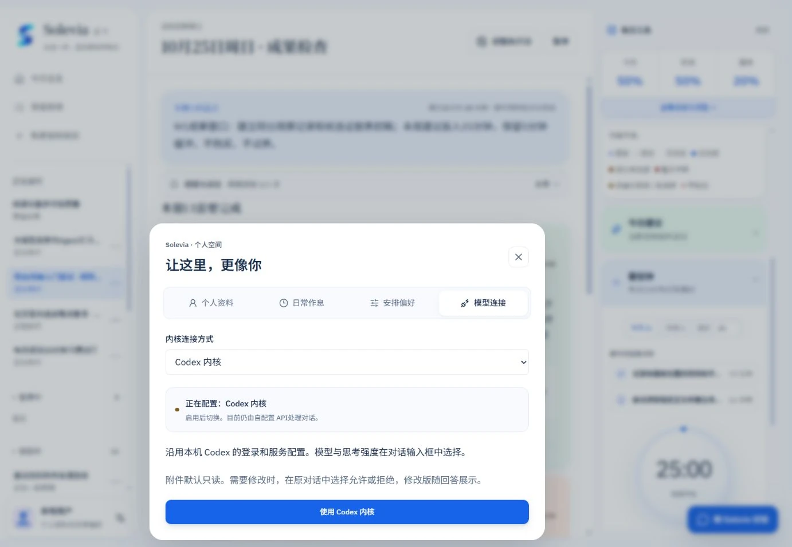

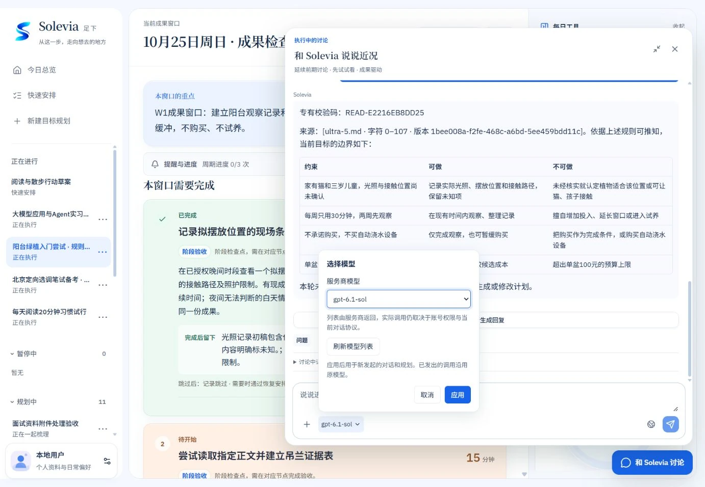

两套配置分别保存，一轮处理结束后即可切换。两种内核共用日期、容量、依赖与任务完整性校验。

---

## 🌟 核心功能

### 💬 聊清需求，才开始规划

从"想学 Agent 开发，但不知道先学什么"这样一句话开始。Solevia 会追问你的基础、期待和投入，把零散想法整理成清晰目标。

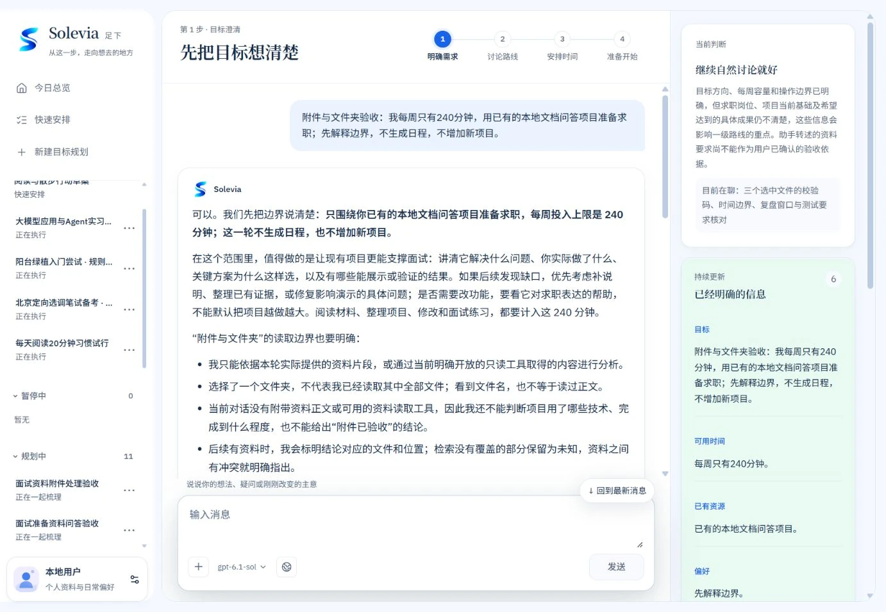

聊过的目标、顾虑、时间与边界会整理成可以回看的需求。随时补充或纠正，让下一步贴合实际情况。

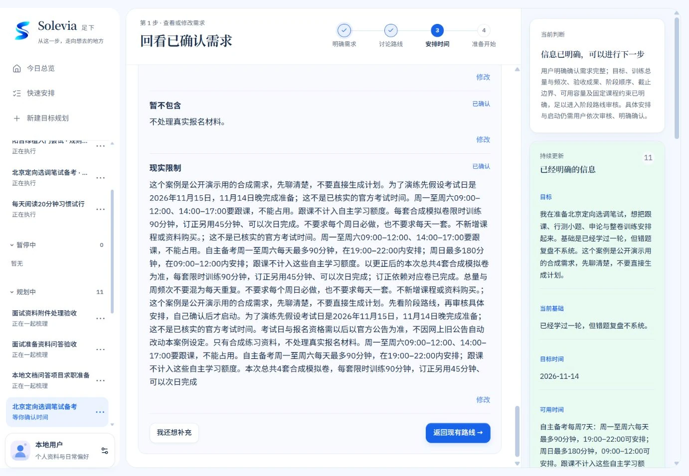

---

### 🗺️ 看得懂的路线图

先看清阶段方向，再展开具体行动。路线说明目的、取舍与预期成果，也把已谈好的目标放在身边。

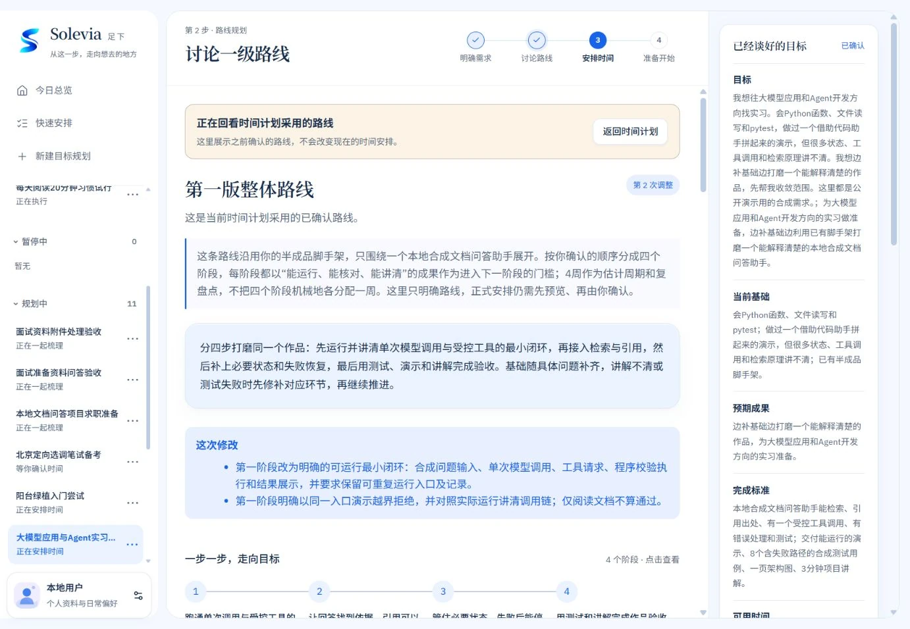

选择一个阶段，可以仔细查看主要内容与阶段产出。学习、练习和作品之间的关系更清楚，讨论也有具体落点。

---

### 📅 融入你的生活节奏

固定课程、会议、休息和日常事务，都可以成为规划的时间依据。阶段任务结合实际容量与先后顺序安排；有明确期限的目标，可以围绕重要日期倒排。

也可以按周阅读，核对这一段时间到底要完成什么。相对时间计划先展示执行顺序，确定开始日期后再落到日历。

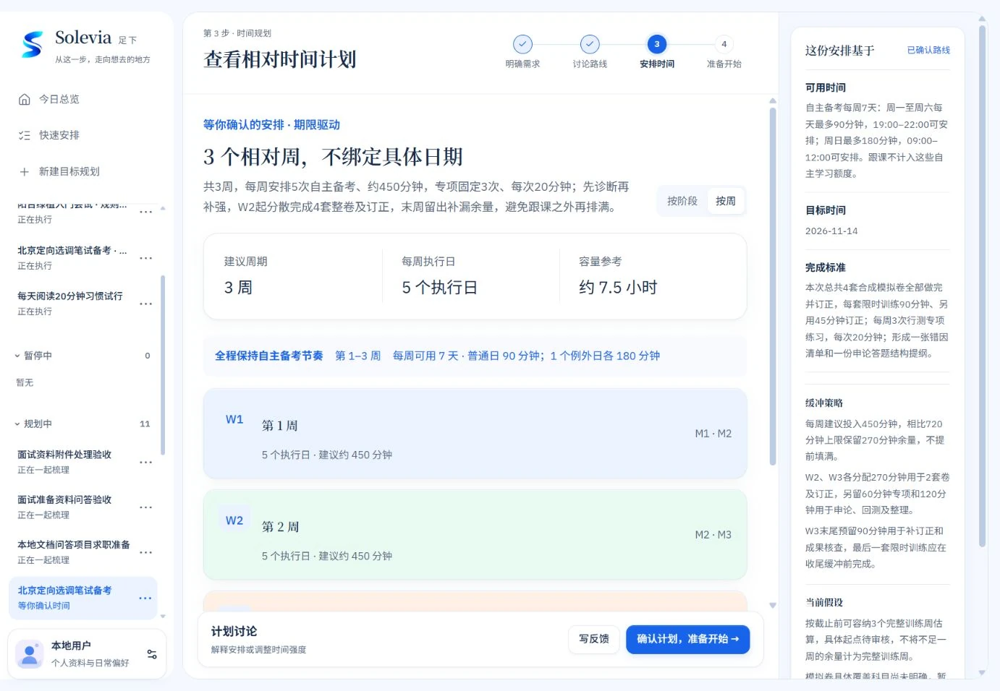

节奏型适合持续积累，探索型适合先尝试、再展开，期限型适合备考与重要交付。每套题后的订正、每篇文章后的审阅、每周训练后的复盘，也能围绕对应任务衔接。

| 方式 | 适合的目标 | 如何推进 |
|---|---|---|
| **节奏型** | 阅读、运动、语言与持续练习 | 围绕频率积累，把复盘融入日常 |
| **探索型** | 兴趣入门、阳台绿植、职业方向尝试 | 先完成有收获的尝试，再根据反馈展开 |
| **期限型** | 备考、求职申请、项目与作品交付 | 围绕期限安排阶段、依赖与可用时间 |

---

### ✅ 实际执行页：今天做什么，打开就知道

下面展示的是 **正在使用的任务执行页面**。分色卡片把行动、预计投入、完成产出与操作放在一起；可以开始、完成、记录部分进度，也可以改期或反馈困难。

同一套界面也能用于技术与求职准备。完成状态和前置任务直接体现在卡片上，已经做过的事和接下来能推进的事都看得见。

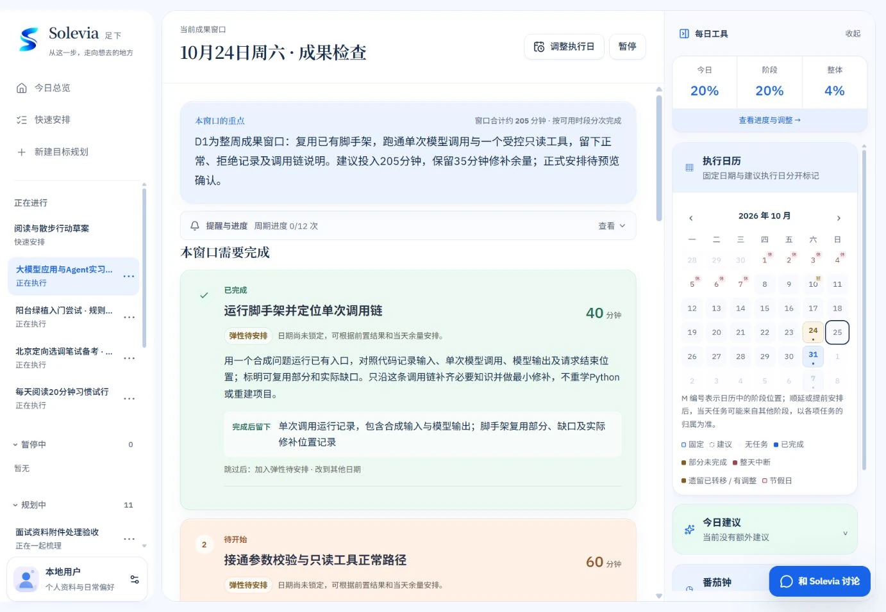

生活探索可以使用成果窗口：在已有时间里观察、核对，再根据反馈决定下一步。不同颜色帮助分清任务，右侧进度与日历、专注工具各有位置。

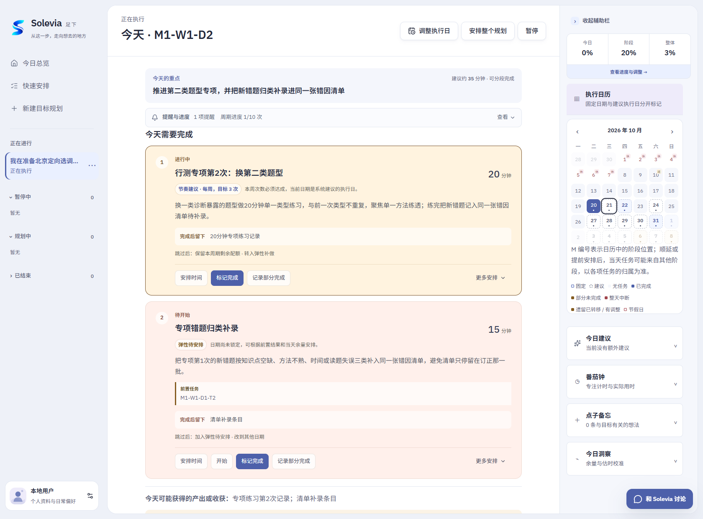

---

### 📆 日历看安排，也看走过的每一天

固定日期、建议执行日以及完成情况分别标记。选择日期即可回看当天任务，结合阶段与整体进度了解自己的步调。

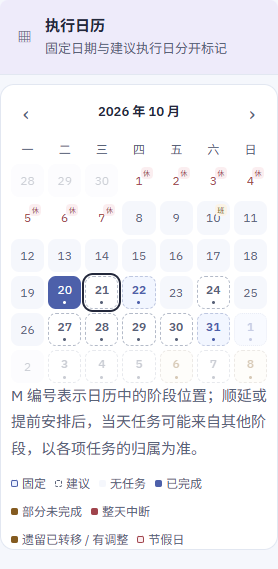

任务较多时，也可以查看其他日期的安排。提醒与周期进度默认收在轻量提示栏，需要时再展开。

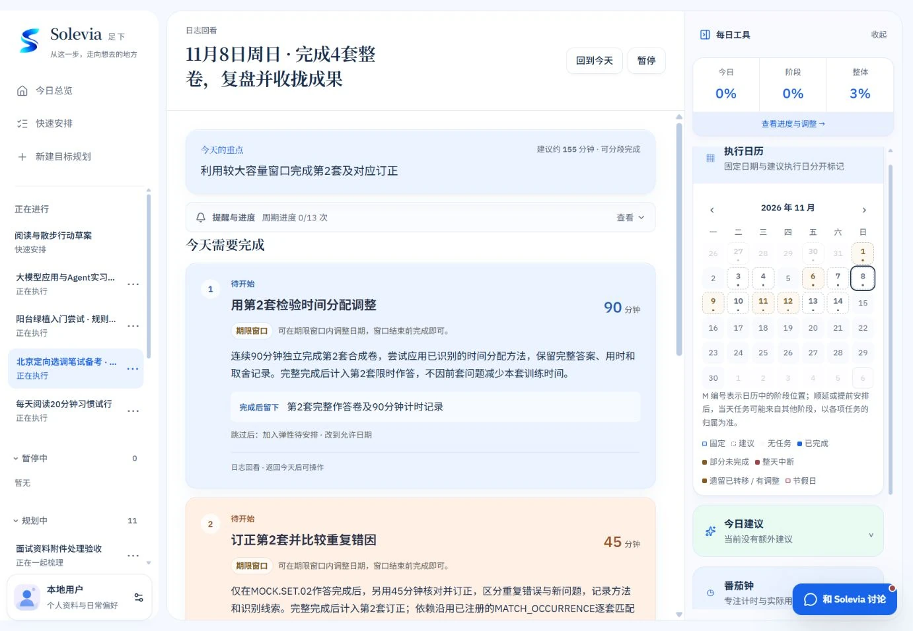

---

### 🔄 中断之后，先看怎么调整，再决定是否继续

漏掉几天后，可以选择保持结束日期追赶、顺延，或讨论剩余任务。预览会列出每项任务的**原日期 → 调整后日期**，以及每天增加多少工作量、最终日期是否变化。同名的每日任务也能逐项对照。

安排过密时，可以要求分散到更多执行日、指定某项补回日期，或设置每日总用时上限。在讨论中补充可用时间，结合剩余容量查看新的安排。

看清调整后，再确认应用到正式计划。系统会核对日期、容量与前置关系，保留过去的执行记录，并把补回任务安排到后续日期。

---

### 🍅 打开番茄钟，把注意力留给眼前的事

可以按今日任务的建议时长开始，也可以自定义节奏。番茄钟就在执行页中，任务、倒计时和最近专注记录放在一起。

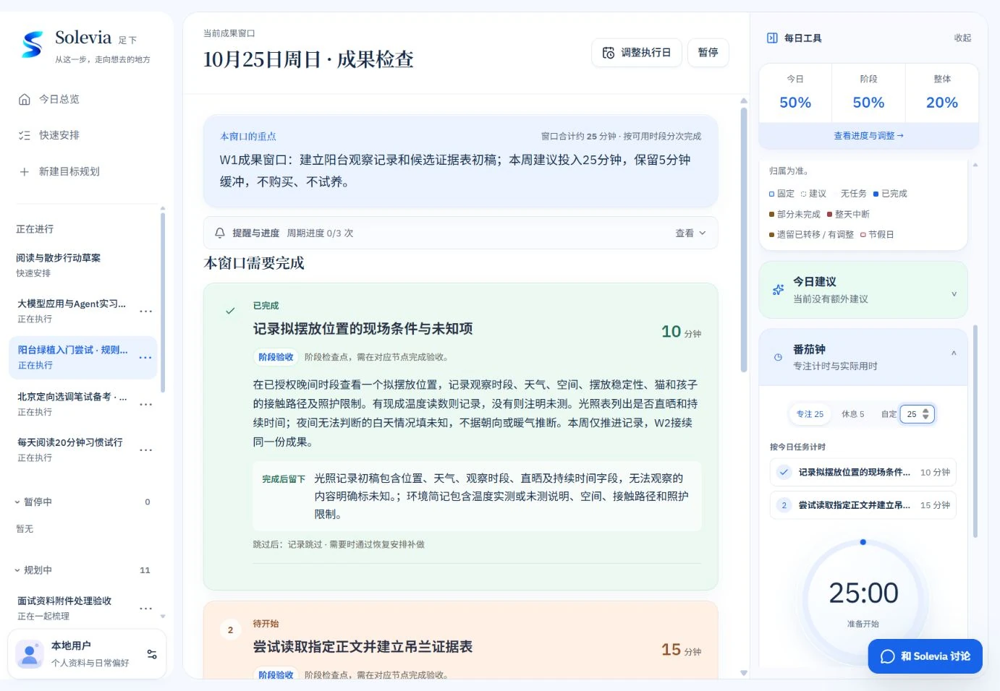

全屏专注用轻柔的玻璃背景收起干扰。退出全屏后计时继续，随时回到任务或讨论；结束时记录实际投入。

---

### 💬 随时提问，带着上下文一起想

执行讨论是轻巧的伴随窗口：正文 14px、表格 13px，附件、模型与发送收在同一行。结合目标和进展，继续讨论理解、困难与下一步。

需要仔细看长回复或表格时，可以展开阅读。切换大小保留草稿、消息和上下文。

输入栏固定在讨论区底部，默认单行，随内容增多自动展开。关闭讨论再打开，可以直接接着已有回答和调整继续聊。

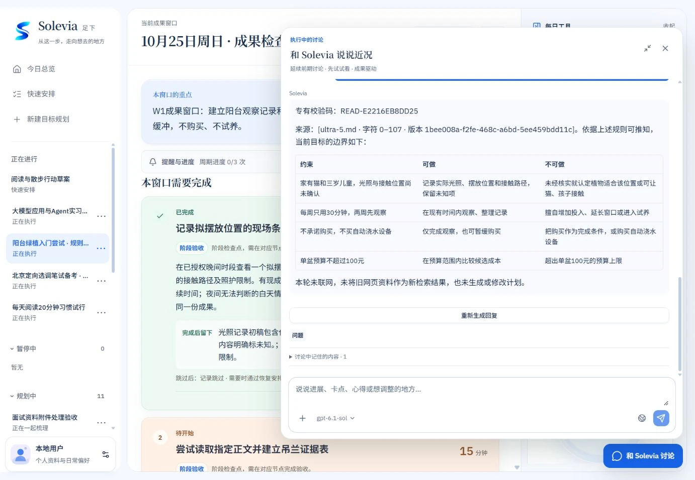

---

### 📁 资料带进来，文件在对话里处理

在输入栏选择文件，也可批量导入文件夹。资料按目标和版本管理，导入后以只读方式交给模型参考。

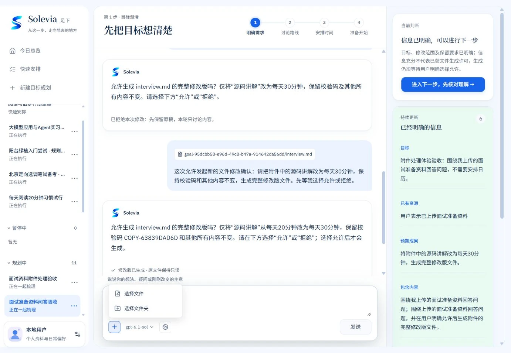

使用 Codex 整理或修改附件时，先在回答下方选择 **允许或拒绝**，也可填写拒绝理由。允许后生成独立修改版，直接预览、下载，原件保持不变。

---

## 📥 下载与安装

### 下载，选好连接，就能开始

1. 在 [Releases 页面](https://github.com/yqf66/Solevia/releases)选择对应版本。0.2.0 的文件名为 **Solevia-Setup-0.2.0-windows-x64.exe**。
2. 安装向导发现本机 Codex 后，会询问 **是否连接 Codex 作为 Solevia 内核？（推荐）**。默认不勾选，由你明确选择；也可以先不连接任何模型。
3. 额外能力默认全部不选；安装器展示安装盘剩余容量并预检空间。基础环境自动准备，无需预装 Python 或 Node.js。
4. 打开 Solevia，在「模型连接」检测并连接 Codex，或填写自己的 API。连接就绪后，即可开始对话与规划。

普通 Codex / API 对话使用基础工作台即可。联网、文档解析、OCR 和语义检索按需选装，也可随时在 **本地用户 → 模型连接 → 补装与管理能力** 中补装。页面显示步骤、耗时、传输流量与下载速度，详细日志按需展开。补装期间业务服务暂停，完成后回到原工作台继续使用。

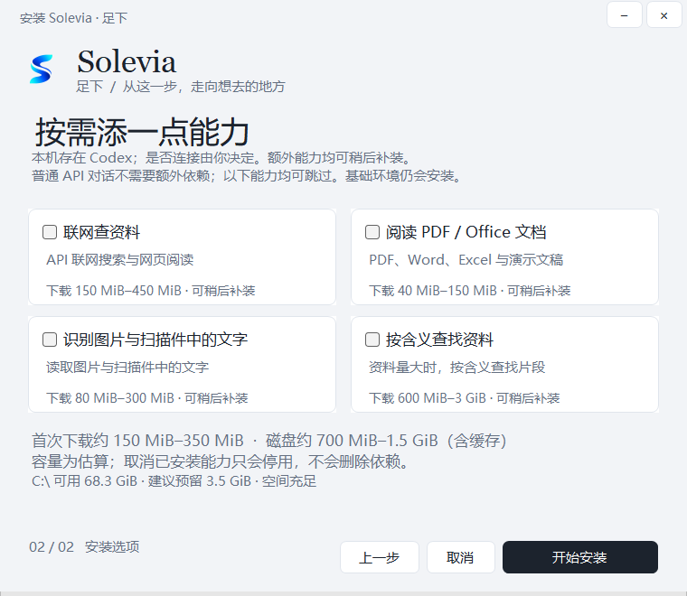

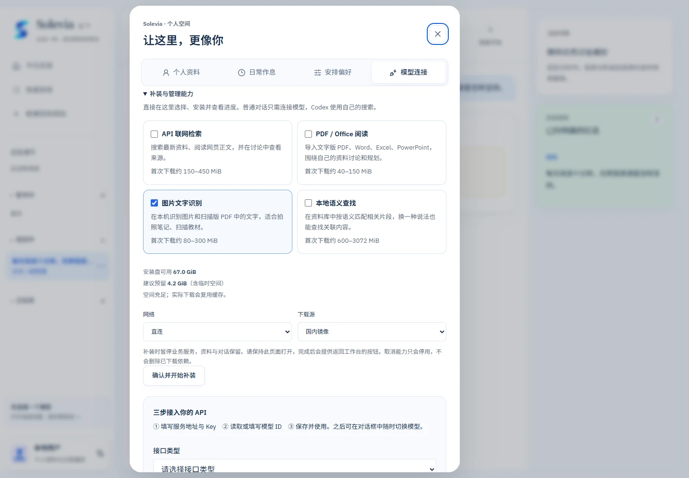

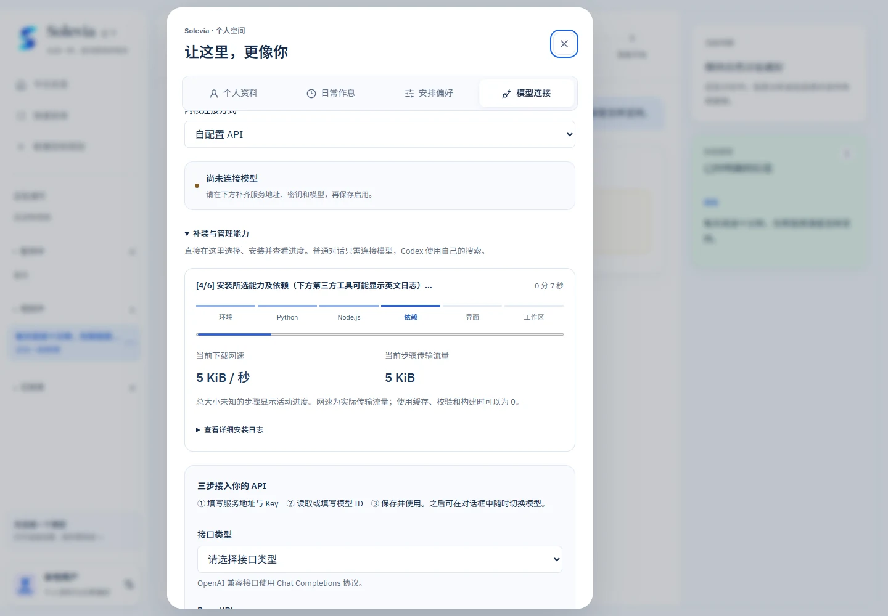

安装后的本地工作台集中管理服务。一个主按钮回到网页，能力管理、更新和日志在下方；关窗后保留在系统托盘，退出时结束本目录的服务。

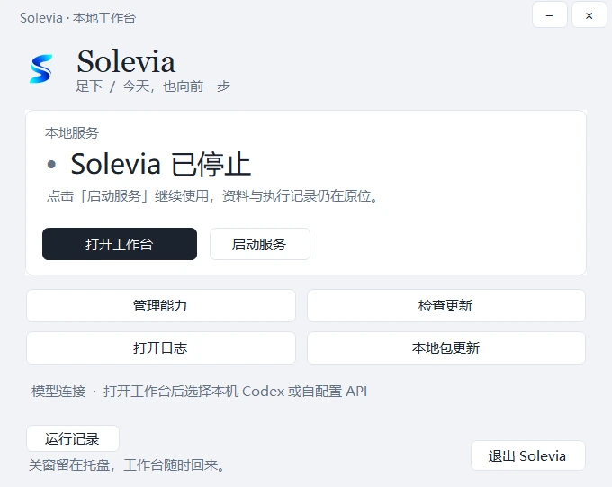

### Codex 接入能有多轻便

**安装时选一次，之后直接在 Solevia 聊天。** 连接适配器随应用准备好，普通使用不需要手动注册 MCP 或安装全局 skill。规则与引导放在 Solevia 的隔离工作区，登录继续由 Codex 管理。

- 复用本机 Codex 登录与配置，连接适配器由 Solevia 管理。
- 导入资料默认只读；修改附件时在对话中确认，生成独立副本。
- 连接帮助包含安装、登录与检测步骤，也支持安装 Solevia 后再完成接入。
- 内置官方指南与 **复制排查指令**。需要时可以让自己的 Codex 帮忙检查，正常连接由 Solevia 自动完成。

完整步骤见 [连接本机 Codex](docs/CODEX_CONNECTION.md)。首次安装通过网络准备运行环境，Codex 按官方指南安装并登录。修复、更新与补装能力保留已有模型连接和个人资料。

| 想做什么 | 图形入口 |
|---|---|
| 安装 Solevia，选择内核 | **Solevia-Setup** 安装程序 |
| 回到网页工作台 | 桌面 / 开始菜单的 **Solevia** → **打开工作台** |
| 补装资料与检索能力 | 网页模型连接，或本地工作台 → **补装与管理能力** |
| 查询新版，确认后更新 | 本地工作台或托盘 → **检查更新** |
| 使用已下载的 ZIP 更新 | 本地工作台 → **本地包更新** |
| 停止并退出 | 本地工作台或托盘 → **退出 Solevia** |

熟悉脚本的用户仍可选择 ZIP 及 Install.cmd、Start.cmd、Stop.cmd、Update.cmd。完整步骤见 [安装与使用指南](START_HERE.md)。

---

## 🎬 适用场景

| 场景 | 可以从这里开始 |
|---|---|
| 🎓 **学习与备考** | "帮我协调课程、专项练习和考前复习" |
| 🌱 **生活与兴趣** | "想在阳台养植物，先了解条件、安排尝试" |
| 💻 **技术与职业成长** | "学会开发 Agent，做一个能展示的作品" |
| 📋 **日常事务** | "把接下来要做的几件事整理一下" |

[📖 发现更多场景 →](docs/examples/README.md)

---

## 🛠️ 系统要求

Windows 10 / 11 64 位（x64），当前版本 Edge、Chrome 或 Firefox。建议至少 4 GiB 内存，同时启用图片识别或语义查找时建议 8 GiB 以上。

| 能力 | 预计下载 | 磁盘增量（含缓存） | 使用时额外内存 |
|---|---|---|---|
| 基础工作台 | 150–350 MiB | 700 MiB–1.5 GiB | 约 0.3–1 GiB |
| 联网查资料 | 150–450 MiB | 500 MiB–1.4 GiB | 约 0.5–1.5 GiB |
| PDF / Office 文档 | 40–150 MiB | 150–500 MiB | 约 0.1–0.5 GiB |
| 图片与扫描文字识别 | 80–300 MiB | 200–800 MiB | 约 0.3–1 GiB |
| 语义查找 | 600 MiB–3 GiB | 2–8 GiB | 约 1–3 GiB |

安装向导会随能力选择汇总下载量与磁盘需求，并检查安装盘剩余空间。建议额外预留 2 GiB 用于临时解压。在线对话使用所选模型服务，无需在本机运行对话大模型。

---

## 🔒 数据与隐私

规划与资料保存在安装目录的 `user-data/`。在线对话会把问题及相关内容通过所选 API 或本机 Codex 发送至对应服务；联网检索会访问搜索和网页服务。Windows 下由 Solevia 保存的 API 密钥使用当前用户加密，Codex 认证继续由本机 Codex 管理。详见 [隐私与数据流向](PRIVACY.md)。

---

## 🤝 参与贡献

欢迎提交问题、建议功能，或参与代码改进！

- 🐛 **报告 Bug**：[提交 Issue](https://github.com/yqf66/Solevia/issues)
- 💡 **功能建议**：分享你的使用场景和需求
- 📝 **完善文档**：帮助改进安装指南、使用教程
- 💻 **贡献代码**：查看 [贡献指南](CONTRIBUTING.md)

---

## ⭐ 如果 Solevia 对你有帮助

- **Star** 这个项目，让更多人发现它
- **分享**给同样需要规划助手的朋友
- **反馈**你的使用场景和改进建议

  
  

---

## 📖 更多文档

[安装指南](START_HERE.md) · [连接 Codex](docs/CODEX_CONNECTION.md) · [更新记录](CHANGELOG.md) · [参与贡献](CONTRIBUTING.md) · [安全反馈与下载校验](SECURITY.md) · [隐私与数据流向](PRIVACY.md)

---

  <strong>Solevia · 足下</strong> 
  千里之行，始于足下 
   
  走出第一步，从一个模糊的想法开始 ✨

  <a href="LICENSE">MIT License</a> © 2026 <a href="https://github.com/yqf66">yqf66</a>

