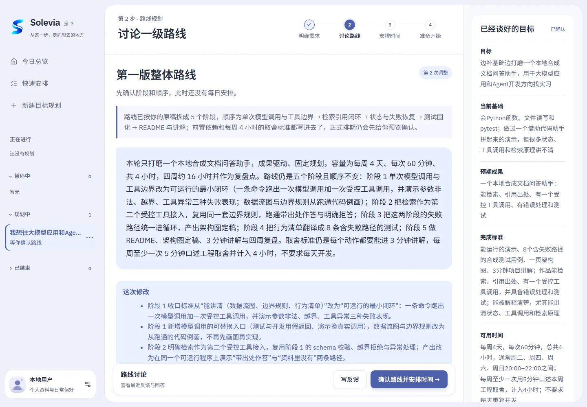

# 学习、生活与技术，都有适合的下一步

从长期成长到日常事务，从明确目标到刚萌生的兴趣，Solevia 帮你找到合适的起点，把想法一步步放进行动。

## 学习与备考：把努力组织成路线

“我想准备一场考试，但课程、练习和复习挤在一起，不知道怎么排。”

和 Solevia 聊聊已有基础、备考范围与可投入时间，将课程、专项训练、模拟练习和阶段复盘串联起来。固定课程留在日历中，练习按合适的节奏推进，重要日期成为准备过程的方向。

**适合搭配：期限型规划 + 节奏练习。**

## 技术与职业成长：从知识点走向作品

“想学 Agent 开发，也想做出一个能演示、能讲清楚的项目。”

从你的基础和目标出发，和 Solevia 一起收敛项目范围，先跑通一个核心闭环，再逐步加入检索、工具调用、失败恢复与测试。每个阶段都有具体产出，技术学习与动手实践沿着同一条路线推进。

**适合搭配：节奏型规划 + 阶段成果。方向尚在比较时，也可以先用探索型规划入门。**

执行中遇到问题，可以带着当前任务继续提问。Solevia 结合已有进度讨论概念、实现思路和下一步行动，让理解与实践相互衔接。

## 生活与兴趣：从一次轻松的尝试开始

“想在阳台养植物，平时又比较忙，怎么开始更合适？”

先了解空间、光照、日常时间和家庭环境，再观察、查资料、比较候选，逐步形成适合自己的实践方式。Solevia 把这些准备整理成可推进的行动和回顾点，让兴趣在一次次体验中生长。

**适合搭配：探索型规划。形成日常习惯后，可以继续安排固定节奏。**

## 日常安排：让零散事务各就各位

“这几天要看资料、准备会议，还想抽时间运动，帮我整理一下。”

直接写下要做的事，用快速安排生成任务草案，编辑日期、时段和重复方式，确认后放入工作区。近期事务与长期目标一起查看，今天从哪里开始更加清楚。

## 为你的目标选一种开始方式

| 你现在的想法 | 推荐方式 |
|---|---|
| 想稳定积累，让练习融入日常 | **节奏型**：形成持续推进的步调 |
| 对方向感兴趣，想先亲手尝试 | **探索型**：先有体验，再决定如何深入 |
| 有明确交付或重要日期 | **期限型**：沿着时间边界安排准备过程 |
| 只是想整理眼前几件事 | **快速安排**：写下来，编辑好，就开始 |

[开始使用 Solevia](../../START_HERE.md) · [返回产品介绍](../../README.md)
